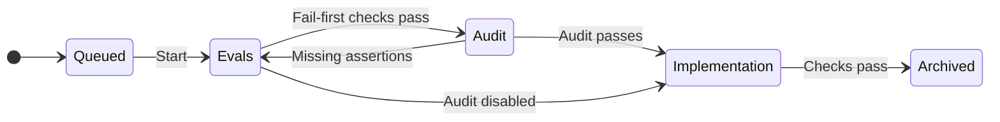

# 🔥🌱 fireweed

Fireweed is a local CLI for spec-driven development in Git repositories. You
describe behavior in Markdown, and coding agents write black-box tests (evals)
and implementation in separate steps. Fireweed checks each step and records it
in Git.

- Each module’s `SPEC.md` defines its behavior, dependencies, and file zones.
  Zones distinguish interfaces, evals, disposable implementation, and preserved
  files.
- Evals reference spec IDs such as `APP-001` in their test names. Project hooks
  emit JUnit XML so Fireweed can check coverage and results across languages.
- A change file in `changes/` describes a spec diff for one module. Fireweed
  applies it to `SPEC.md` and archives it after verification passes.

## Get started

Build from this checkout with Go 1.23 or later. Add this checkout’s `bin/`
directory to your `PATH` to use the build in another repository.

```sh
make build
```

In a new project directory, initialize Git and choose a recipe and an agent CLI.
This example uses Go and Codex.

```sh
git init -b main
go mod init example.com/my-project
fireweed init --recipe go --agent codex
```

Follow the printed recipe to finish setup, describe the project in `SYSTEM.md`,
and commit the setup files. Run `fireweed doctor` to check the project’s hooks
and configured agent commands.

## Apply a change

```sh
fireweed playbook author-change
fireweed new-change app first-behavior
```

Fill in the generated change file with the motivation and spec edits. Use
`fireweed stamp <change>` for edits that modify or remove existing specs. Commit
the change file and land it on the configured base branch, then run
`fireweed next` from a clean worktree to process the next eligible change.



New or modified specs need a failing eval before implementation, with explicit
exceptions for existing behavior and review-only specs. Implementation runs
against the frozen evals. `fireweed run` processes the queue within configured
limits. To drive the example manually, use `fireweed start first-behavior` and
read `fireweed context first-behavior` before each step. Use `fireweed verify`
to check the step and `fireweed done` to commit and advance it.

Use `fireweed status` to inspect the queue, `fireweed check` to validate project
files, and `fireweed ci` to run automated checks in CI.

## Test regeneration

Run `fireweed drill <module>` to test whether a module can be rebuilt.

- **Keeps** the module’s spec, Decisions, interface, evals, and other retained
  files, plus dependency interfaces and `SYSTEM.md`, as agent inputs.
- **Rebuilds** only the module’s disposable files in an isolated workspace.
- **Checks** eval results and spec coverage for the rebuilt module and all its
  dependents in a separate worktree.

Review the results in `.fireweed/drills/<module>.md`.

This repository uses Fireweed for its own rebuild. Contributors use the pinned
controller described in [AGENTS.md](AGENTS.md). See the [design](fireweed-design-v1.md)
for the full workflow and the [rebuild progress](docs/rebuild/PROGRESS.md) for
the current status.
