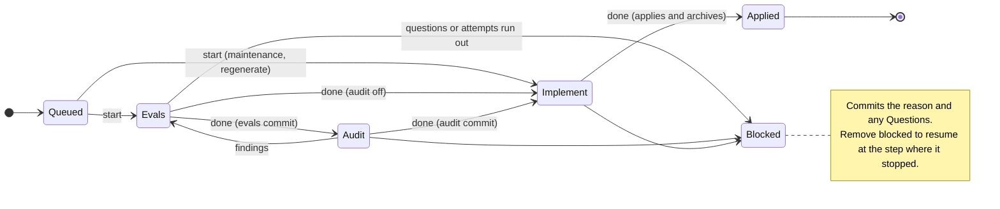

# fireweed design

Draft · October 14, 2026

fireweed is a single Go binary that runs a spec-driven, regenerative workflow for one or a few developers. Specs are the source of truth, black-box evals linked to spec IDs are kept permanently, most implementation code can be thrown away and rebuilt, and coding agents do the work while fireweed checks every step.

## Goals and principles

fireweed makes "delete the code and regrow it from the spec" a safe, routine operation, and makes agent-written code trustworthy by checking it rather than trusting it.

**Who it is for.** One developer, or a few, building a new project with coding agents such as Claude Code or Codex. Merging a change file into the base branch is the developer's approval of that change. Adopting fireweed in an existing codebase is not a goal yet, but nothing in the design rules it out (see Room for existing codebases).

**What sets it apart from other spec-driven tools:**

1. **A module contract.** Each module declares which files are its interface, evals, disposable code and preserved code. fireweed enforces those zones.
2. **Spec IDs link tests to specs.** Test names carry spec IDs, evals report JUnit, and coverage is a mechanical lookup that works in any language.
3. **Changes are a queue of spec diffs.** Each change adds, modifies or removes specs in one module and is applied in order.
4. **A checked, step-by-step protocol.** Evals are written first and must fail, an audit checks them against the spec, and then implementation must make them pass without touching the evals. fireweed verifies each step after the fact and rejects violations.
5. **Regeneration.** Rebuilding a module from its spec and evals follows from 1 to 4.

**Principles every design choice follows:**

- **Check, don't trust.** Agents are asked to follow rules, but fireweed verifies the result deterministically. The rules that matter are enforced on file paths and test results, not on agent goodwill.
- **Language-agnostic core.** fireweed knows nothing about any programming language. Language-specific work happens in hooks the project provides, and fireweed proves those hooks work.
- **Opinionated defaults, declared contracts.** A new project gets one recommended layout. That layout is just the default values of a contract each module declares, so other layouts work too.
- **Local and dependency-light.** The binary never touches the network. It needs git, the project's own hooks, and an agent CLI. It never pushes, opens pull requests or schedules anything.
- **State lives in git and files.** Every piece of workflow state is either in a committed file or in a local git ref, so any session, human or agent, can pick up where another stopped.
- **Easy for agents to drive.** Every command is non-interactive, has machine-readable output, and has stable diagnostic codes.

## Repository layout

A project created with `fireweed init` has one config file, one project document, a change queue, a protected `.fireweed/` directory and its modules. Only the module layout is a default; everything else is fixed.

```
fireweed.yaml            # version pin, format version, base branch, module defaults, hooks, agent, protected globs
SYSTEM.md                # product description, project decisions and conventions (plain document)
AGENTS.md                # contains a block fireweed manages, between markers (protected)
changes/                 # the pending queue: NNNN-slug.md
  archive/               # applied changes, never edited
.fireweed/               # protected from workers
  templates/module/      # module templates, copied from the recipe
  canaries/              # violations doctor plants to test each hook
  playbooks/             # optional playbook overrides
  drills/                # drill reports, one per module
  boundaries-baseline    # existing boundary violations, if any
  ...                    # boundary-checker configs and other glue
  runs/                  # gitignored: agent logs per run
packages/                # default module location
  app/                   # composition-root module created by init
    SPEC.md
    src/
    evals/
```

fireweed's own bookkeeping that should not be committed lives in local git refs under `refs/fireweed/` and in scratch worktrees under the git directory (see Git behavior). Nothing it creates appears in `git status` unless it is meant to be committed.

## Modules and the zone map

A module is a directory containing a `SPEC.md`, and its frontmatter declares a zone map: which files belong to which zone. The zone map, not the directory layout, is the contract fireweed enforces.

Internally, fireweed resolves every path in the repository to a module (or none) and a zone. Almost every check works on that mapping plus a git diff, which is why the core needs no language knowledge. fireweed looks for `SPEC.md` files only under the `modules` globs in `fireweed.yaml`, and `check` warns about any `SPEC.md` outside them.

```yaml
---
name: auth
id_prefix: AUTH
depends_on: [clock]
interface: [src/index.ts]        # globs, relative to the module directory
evals: [evals/**]
disposable: [src/**]
preserve: [src/migrations/**]
append_only: [src/migrations/**]
---
```

Any zone field left out takes its value from `module_defaults` in `fireweed.yaml`, so a module using the recommended layout needs only `name`, `id_prefix` and `depends_on`. A Go module might instead declare `interface: [auth.go]`, `evals: ["*_eval_test.go"]` and `disposable: [internal/**]`.

| Zone | Default | Evals phase | Impl phase | Regeneration |
| --- | --- | --- | --- | --- |
| Interface | `src/index.ts` (per recipe) | May edit | Read only | Kept |
| Evals | `evals/**` | May edit | Read only | Kept |
| Disposable | `src/**` | New stub files only | May edit | Deleted, rebuilt |
| Preserved | none | Read only | May edit | Kept |
| Append-only | none | Read only | May add, never edit or delete | Kept |
| SPEC.md | `SPEC.md` | Read only | Read only | Kept |
| Other module files (manifests) | everything else in the module | May edit | May edit | Kept |
| Protected | `fireweed.yaml`, `SYSTEM.md`, `.fireweed/**`, every `AGENTS.md` and `CLAUDE.md`, configured globs | Read only | Read only | Kept |

When a file matches several zones, the strictest wins, in this order: protected, `SPEC.md`, evals, interface, append-only, preserved, disposable, other module files. So an interface file is read-only in the implementation step even though it is also preserved, and a preserved file is never deleted on regeneration even when a disposable glob matches it.

**Invariants `fireweed check` enforces:**

- Every path belongs to at most one module.
- Interface files and append-only files are always treated as preserved, whether or not `preserve` lists them.
- The evals zone and the disposable zone do not overlap.
- `depends_on` names existing modules, never the module itself, and has no cycles.
- `id_prefix` is unique across modules.

Files outside every module belong to humans. Workers may not touch them, except paths listed under `worker_writable` in `fireweed.yaml`, such as a workspace lockfile that changes when a module adds a dependency. Recipes set this list.

## Specs

Specs stay in Markdown: each item is a `### PREFIX-NNN` heading under a single `## Specs` section, with a body that states one observable behavior using MUST, MUST NOT or SHOULD. Only fireweed edits the `## Specs` section, by applying changes.

```markdown
## Specs

### AUTH-014
A login MUST be rejected for 15 minutes after 5 consecutive failed attempts for the same account.

### AUTH-020 [review]
Error messages MUST NOT reveal whether an account exists.

### AUTH-021 [quarantine: flaky clock in CI, see change fake-clock]
A session MUST expire 24 hours after its last use.
```

**Tags describe two separate things:**

- **How a spec is verified.** By default, by evals. `[review]` marks a spec that no deterministic test can check; it needs no evals. The PR body lists every review-tagged spec a change adds or modifies, and a human judges it during review.
- **Whether it is currently enforced.** `[quarantine: <reason>]` suspends enforcement and requires a reason. Every quarantined spec is listed by `fireweed status` and in every PR body until the tag is removed.

**IDs.** IDs are assigned by fireweed when a change starts, never chosen by authors (see Change files). A removed ID is never reused; fireweed tracks removed IDs through the archive.

**Matching IDs in test names.** A test covers a spec when the spec's ID appears in the JUnit testcase name or classname. Matching ignores case, treats `-` and `_` as equal, and allows the separator to be missing, so `AUTH-014`, `AUTH_014`, `AUTH014` and Python's `test_auth_014` all match. The ID must not be preceded by a letter or digit or followed by a digit, so `AUTH0145` and `OAUTH014` do not match. This lets languages such as Go, whose function names cannot contain a hyphen, follow the convention.

**System-wide behavior lives in composition-root modules.** There is no system pseudo-module. A root module such as `app` wires other modules together; its interface is the product's external surface (an HTTP API, a CLI), its `depends_on` lists the modules it composes, and its evals are end-to-end tests. It is ordinary disposable code that follows every rule. A product with several entry points has several root modules.

**SYSTEM.md is a plain document.** It holds the product description, project decisions (language, frameworks, deployment) and conventions. It has no spec IDs, workers cannot edit it, and humans edit it directly. Cross-cutting rules such as "never log personal data" go here as conventions, checked by the audit and by review rather than by evals.

**Decisions.** A worker records any behavioral choice the spec did not cover in the change file's `## Decisions` section. When the change is applied, fireweed appends those decisions to a `## Decisions` section of the module's `SPEC.md`, which only fireweed edits, tagging each with the change's slug. Regeneration reads them, so a rebuilt module makes the same choices. A later change can drop decisions that a spec now covers or that no longer hold by quoting them in a `## Removed decisions` section, and drill reports flag decisions the rebuilt code contradicts.

**Spec history.** `fireweed show <module> <ID> --history` lists the archived changes that added, modified or retagged a spec, newest first, with each change's Motivation, Decisions and provenance. It answers why a spec exists without digging through git history.

## Change files

A change file describes how one module's specs should change. The queue is the set of files in `changes/`, run in order of number and then slug, and merging a change file into the base branch is the developer's approval.

```markdown
---
module: auth
set:
  append_only: [src/migrations/**]
bases:
  AUTH-003: 9f2c1a07
---

## Motivation
Accounts are being brute-forced; lock them after repeated failures.

## Interface
Add a `lockedUntil` field to the login error response.

## Added

### new:lockout
A login MUST be rejected for 15 minutes after 5 consecutive failed attempts for the same account.

## Modified

### AUTH-003
A failed login MUST return error code `invalid_credentials` and, when locked, `lockedUntil`.

## Removed

## Decisions

## Rejected alternatives
IP-based throttling: shared IPs would lock out whole offices.
```

**Ordering and numbering.** Files are named `NNNN-slug.md`. Numbers only order the queue and need not be unique; changes that share a number run in slug order. Two changes written in parallel without knowing about each other have no meaningful order anyway. Nothing refers to a change by its number.

**New spec IDs are assigned late.** New specs use a placeholder handle such as `new:lockout`. When the change starts, fireweed replaces each handle with the next free ID for the module, for example `AUTH-014`. Implementation runs one change at a time in base-branch order, so two authors working in parallel can never claim the same ID. Handles are `new:<slug>`, with the slug limited to lowercase letters, digits and hyphens and unique within the change. Other specs and the Interface section refer to a handle by the same string, and `start` rewrites every occurrence in the change file. A change may not use another change's handle: `check` reports an error, and the authoring playbook combines such changes into one. Evals never see handles, because they are written after `start`.

**Stale changes are caught.** `bases` records a short hash of each spec text the change modifies or removes, as it stood in the projected spec when the change was written. If another change has since altered that spec, `fireweed check` reports the change as stale and it must be rewritten. This prevents one change silently overwriting another's edit. Each hash is the first 8 hex characters of a SHA-256 over the spec item, tag included, with line endings and trailing whitespace normalized. Including the tag means that adding `[quarantine]` counts as an edit. A Modified or Removed spec with no `bases` entry is a `check` error, and the authoring playbook runs `stamp`.

**Frontmatter fields:**

| Field | Set by | Meaning |
| --- | --- | --- |
| `module` | Author | The one module this change targets |
| `set` | Author | New values for module frontmatter: `depends_on`, `interface`, `evals`, `disposable`, `preserve`, `append_only`, `boundaries_opt_out` and per-module hook overrides. `name` and `id_prefix` cannot be changed |
| `bases` | fireweed, when the author runs `fireweed stamp` | Hashes of the spec versions this change was written against |
| `fixes` | Author | Spec IDs whose behavior is already specified correctly but whose evals missed a bug. The evals phase must add a failing test reproducing it |
| `already_satisfied` | Author | New or modified spec IDs whose evals may pass before implementation, such as clarifications of existing behavior |
| `regenerate` | Author | `true` rebuilds the module from scratch (see Regeneration) |
| `run` | fireweed (on start) | Unique ID of the run implementing this change, which also locates its logs |
| `phase` | fireweed | The next step to do: evals, audit or impl, and applied once archived |
| `blocked` | fireweed or agent | Why the change is stuck. Removing it unblocks the change |

**Body sections.** Motivation is required. Interface describes interface changes in prose; the evals phase turns them into code, which keeps change files independent of language. Added and Modified contain complete spec items; Removed contains headings only. Decisions is filled in by the worker. Questions is written by an agent that blocks the change because the spec is ambiguous. Removed decisions quotes module Decisions to drop. Provenance is written by fireweed at each step. Rejected alternatives and Notes are free prose.

**Kinds of change**, derived from the content:

- **Spec change:** has Added, Modified or Removed specs. Runs evals, audit and implementation.
- **Fix:** has `fixes` and no spec edits. Runs the same phases; fail-first guarantees a test reproduces the bug.
- **Maintenance:** no spec edits and no `fixes`, such as a refactor or dependency upgrade. Skips evals and audit.
- **Regenerate:** `regenerate: true`. Implementation starts with the module's disposable files deleted.

Applied changes move to `changes/archive/` with all their state fields intact and are never edited again.

## Change lifecycle

Each change moves through a fixed sequence of states, and fireweed checks the working tree and makes one commit at each step. Agents do the work inside a step; fireweed alone decides whether the step is done.



`start` moves a queued change into Evals, and each `done` commits and advances it. A blocked change resumes at the step where it stopped.

**Driving the state machine.** Three commands move a change forward, and anyone can run them: an unattended agent, an agent in an interactive session, or a human.

- `fireweed start <change>` checks preconditions, claims the change, assigns spec IDs, records `run` and `phase`, and prints the context for the first step.
- `fireweed verify` runs the current step's checks without committing, so an agent can iterate.
- `fireweed done` runs the same checks and, if they pass, commits and advances the state. After implementation it also applies and archives the change.

`fireweed next` and `fireweed run` are thin loops on top: they start an agent for each step, call `verify` and `done`, and retry on failure. `next` runs the head of the queue once; `run` keeps going until the queue is empty or a limit is reached. Agents never commit; if an agent creates commits, fireweed undoes them with a soft reset and logs a warning.

**State fields.** `phase` names the next step to do: `evals`, `audit`, `impl`, or `applied` in the archived file. `start` writes the first value without committing it: `evals` for spec changes and fixes, `impl` for maintenance and regenerate changes. Each commit is identified by the value it sets: a commit that sets `applied` is an implementation commit, one that moves `phase` from `audit` to `impl` is an audit commit, and any other commit that sets `audit` or `impl` is an evals commit (with the audit turned off, the evals commit sets `impl` directly). A commit that adds `blocked` is a block commit. `blocked` is a separate field: `phase` says where to resume and `blocked` says why the change stopped, so unblocking is deleting one line.

**Starting a change.** `start` requires a clean working tree and an eligible change (the queue head, or the first one not held back by a blocked change). It warns if HEAD does not contain the base branch's tip, which means the queue may be stale. It creates the claim ref, replaces `new:` handles with real IDs, and writes `run` and `phase` into the change file.

**Zones during a change.** Every check uses the projected zone map: the module's frontmatter with the change's `set` values applied. A change that adds an `append_only` glob or moves the interface is checked against the new zones from its first step.

**Resuming.** `start` on a change that already has a committed `phase`, or whose `blocked` was removed, resumes it: it keeps `run`, assigns no IDs, and claims the change again. `start --from-attempt <n>` also loads a saved attempt into the working tree.

**The current change.** Each claim records the worktree that holds it. `verify` and `done` act on the change this worktree holds, or on a change named as an optional argument.

**Approval.** Merging a change file into the base branch is its approval, so `start` warns when the change file is not on the base branch. `run`, which works unattended, skips such changes unless given `--allow-unmerged`.

**Evals step.** The agent writes tests only, plus interface changes the change describes.

- Changed files must be in the module's evals or interface zones, or be the change file itself (for Decisions and Questions). The step may add new disposable files for stubs so that evals compile, but may not modify or delete existing ones, so fail-first runs against the existing code plus the new stubs. A stub that belongs in an existing package goes in a new file there. The step may also edit the module's other files, such as its manifest to add test dependencies, and `worker_writable` paths. Those files are listed in the PR body, and fail-first catches any stub that fully implements the behavior, because its tests would then pass. Recipes show what a stub looks like in each language.
- Every ID in Added, Modified and `fixes` must have at least one test referencing it, except `[review]` specs, which need no evals. Every test that references a Removed ID must be deleted or renamed; coverage reports an error for any test referencing an ID that does not exist in the projected spec.
- **Fail-first:** for every such ID, at least one referencing test must fail before implementation, unless the ID is listed in `already_satisfied`. A test that errors, for example by calling a stub that throws, counts as failing. A compile or collection failure produces no testcases for the IDs, so it already fails the rule above.
- `done` commits the tests, the interface, the assigned IDs and the state change together.

**Audit step** (on by default; `audit.enabled: false` in `fireweed.yaml` turns it off). A separate agent, ideally a different model from the one that wrote the evals, reads only the change, the spec and the evals. It reports spec clauses that no test asserts: limits never tested, MUST NOTs checked only on the happy path.

- The auditor writes its findings into an `## Audit` section of the change file. Each finding must name a spec ID and quote the clause it concerns; fireweed discards findings that don't cite a real clause, which keeps the auditor off style comments.
- Any remaining finding sends the change back to the evals step with the findings in the prompt. That retry counts against the evals step's attempts.
- A finding that a clause cannot be tested at all is a spec problem, not an eval problem: it becomes a question and blocks the change.
- `done` commits the findings with the state change, so the PR shows what was checked. A passing audit writes "No findings" and lists the IDs it checked.

**Findings format.** One line per finding, naming the spec ID and quoting the clause exactly:

```markdown
## Audit
- AUTH-014: "after 5 consecutive failed attempts" — no test covers the fifth attempt
- [untestable] AUTH-020: "MUST NOT reveal whether an account exists" — depends on wording, not behavior
```

fireweed keeps a finding only if the ID exists and the quote is an exact substring of that spec. If `audit.command` is not set, the worker's command is used and doctor warns that the auditor shares the worker's blind spots; `init` takes an `--audit-agent` flag.

**Implementation step.** The agent writes code.

- Changed files may not be in the evals or interface zones, any `SPEC.md`, or a protected path. Only the current change file may change in `changes/`.
- Append-only files may be added but not modified, deleted or renamed.
- The module's evals and the evals of every module that depends on it, directly or indirectly, must pass. `verify_dependents: all | direct | none` controls how far this reaches (default `all`); `fireweed ci` always runs everything, so a lower setting still catches breakage before merge. The `boundaries` hook must pass.
- `done` applies the change to `SPEC.md` (specs, Decisions, `set` values), archives the change file, runs `fireweed check`, and commits everything together. Preserved files that changed are listed in the PR body.

**Retries.** Each step gets a fixed number of attempts (default 2) and a timeout per attempt. A retry keeps the earlier work and adds the last verification output to the prompt. When attempts run out, fireweed saves the work as a commit on `refs/fireweed/attempts/<change>/<n>`, restores the working tree, and blocks the change. That work can be inspected, or continued by hand with `start`.

**Usage limits.** A non-zero agent exit whose last 20 lines of output match the configured `limit_patterns` is a usage limit, not a failed attempt. fireweed waits `limit_wait` (default 30m) and repeats the same attempt. It stops cleanly, with exit code 3, when the total wait would pass `limit_budget` (default 4h) or the `--for` time limit.

**Blocking.** There are two kinds, handled differently:

- **The agent blocks the change** because the spec is ambiguous or contradicts existing code. It writes a `## Questions` section and a `blocked` reason. The author answers by editing the change and removing `blocked`.
- **Attempts run out.** fireweed writes the reason. This is an implementation problem: retry later, with more attempts, a different model, a smaller change, or by hand.

Either way fireweed commits the blocked state. A block commit contains the state `start` wrote (IDs, `run`, `phase`) plus `blocked` and any Questions, but none of the step's work, which goes to the attempt ref. IDs are therefore fixed once assigned.

The queue does not stop. Later changes wait if they target:

- the blocked module;
- a module that depends on it, directly or indirectly;
- a module it depends on, if the later change has a non-empty Interface section.

Everything else runs. This is deterministic because only the Interface section can change an interface: the evals step edits the interface only as that section describes, and the implementation step cannot touch it.

**Each change lives entirely in its own commits.** ID assignment, state, specs, archive move, evals and code are all in the change's commits, so `git revert` of those commits undoes the change completely and returns it to the queue.

**Provenance.** Each `done` appends one line to the change file's `## Provenance` section: the step, the date, the configured agent command (including its model) or `manual` when a person did the work, the fireweed version, the hash of the playbook used, and result counts such as tests added, failing before and passing after. Logs stay local in `.fireweed/runs/`; this record is committed and kept in the archive with the change.

## Regeneration

Regeneration has two separate jobs: checking whether a module's spec and evals are enough to rebuild it (a drill), and actually replacing its code (a regenerate change).

**Drills check disposability.** Until a module has been rebuilt from its spec, "disposable" is only a claim. Behavior leaks into code without anyone noticing: an edge case one change handled but no spec states, an ordering a caller depends on. `fireweed drill <module>` tests the claim:

1. Create a scratch worktree, run the `setup` hook, delete the module's disposable files, and have the agent rebuild them from the spec, Decisions, interface and evals.
2. Run the module's own evals. A failure after a clean rebuild means the evals depend on internals or on the environment.
3. Run the evals of every module that depends on it, including root modules. **This is the strongest signal.** Dependent modules use the module the way real code does, so a dependent whose evals pass against the old code but fail against the rebuilt code relies on behavior the spec never states.
4. List any Decisions the rebuilt code contradicts. These are the best candidates to become real specs.
5. Write a `.fireweed/drills/<module>.md` report: frontmatter with date, base commit, agent, model and result, then sections for own evals, dependent evals (module, test, spec ID and result), contradicted Decisions, and gaps. Each gap names the nearest spec ID, or "no spec", and the module a fixing change would target.
6. Keep the rebuilt code on `refs/fireweed/drills/<module>/<date>` and remove the worktree.

The developer reviews the report, commits it like any other file, and turns the gaps they agree with into changes. Choosing which gaps become changes is the approval; fireweed never writes changes from a drill.

Drills run only on demand, because scheduling would need an external trigger. `fireweed status` shows, per module, how many changes have been applied since its last drill (counted from the base commit in its drill report), so drift is visible without scheduling anything.

**Regenerate changes replace code.** To actually rebuild a module, for a stack upgrade, a framework switch or accumulated cruft, the developer writes a change with `regenerate: true` and a Motivation. It runs through the normal lifecycle as a maintenance change, except that the implementation step starts with the module's disposable files deleted. Its evals and dependents' evals must pass as usual.

`start` warns when a regenerate change targets a module with no passing drill since its last applied change. A stack upgrade becomes an ordinary pattern: update the project decisions in `SYSTEM.md`, then queue regenerate changes for the affected modules in dependency order.

## Language support

fireweed delegates language-specific work to hooks, publishes the facts the hooks need, and proves the hooks work. It ships no language plugins.

**What fireweed does natively, in any language:** parsing specs and changes, the queue, zone checks on git diffs, joining JUnit results to spec IDs, and regeneration. Most of the tool's value is here.

**Hooks** are commands declared in `fireweed.yaml`, with per-module overrides. Each has a small contract:

| Hook | Contract | Required |
| --- | --- | --- |
| `eval` | Runs a module's evals and writes JUnit XML to `{report}`. Receives `{module}`, `{module_dir}` and `{report}` | Yes, for every module |
| `boundaries` | Runs across the project and prints one violation per line, prefixed with the module name: imports of modules outside `depends_on`, and evals that use anything beyond the interface | Yes, for modules with disposable globs (below) |
| `setup` | Prepares a fresh worktree, for example installing dependencies | No |

**fireweed owns the module graph.** `depends_on` lives only in `SPEC.md` files. `fireweed modules --json` publishes the resolved modules, zones, interfaces and dependencies, and the glue code reads it from there: generating dependency-cruiser rules, import-linter contracts, workspace dependencies and so on. There is never a second copy of the graph to drift.

**Glue lives in protected zones.** Boundary-checker configs and other glue go in `.fireweed/` or another protected glob. Otherwise a worker could make the boundary check pass by weakening it.

**`fireweed doctor` proves each hook works.** In a scratch worktree, it creates two throwaway modules from the module templates and plants a canary for each rule: an import from an undeclared module, an eval that reaches past the interface, a failing eval, an eval with no spec ID. Each hook must catch its canary, and must pass once the canary is removed. Canary snippets come from the recipe or from whoever built the glue, in `.fireweed/canaries/`. A hook replaced by `exit 0` fails doctor immediately.

**When boundary checks are required.** Boundaries matter most for modules that may be regenerated, so the rule follows disposability:

- A module with any disposable globs requires a working `boundaries` hook and canaries. The recommended layout makes `src/**` disposable, so new projects require it by default.
- A module with no disposable globs gets a warning instead.
- Opting out is explicit: `boundaries_opt_out: "<reason>"` in the module's frontmatter. `doctor`, `status` and PR bodies report every opt-out.
- A baseline file, `.fireweed/boundaries-baseline`, records existing violation lines so that only new ones fail. fireweed assigns each violation line to its module, ignores opted-out modules and baselined lines, and fails on the rest. New projects rarely need it; existing codebases will.

**Recipes** package an opinionated setup for one stack: a document the agent follows, module templates, canary snippets and default hook commands. The first three are TypeScript with pnpm workspaces, Python with uv, and Go, covering three enforcement styles: package exports, an import linter, and Go's internal directories plus a dependency linter such as depguard. Recipes are embedded in the binary, and `init` copies the chosen recipe into `.fireweed/`. After that the copy belongs to the project, because the agent adapts it to the repository and an automatic upgrade would break that work. A third-party or homemade recipe is a local directory passed as `--recipe ./path`. For an unsupported stack, `--recipe none` writes the minimum and prints the hook contract. The agent then implements the hooks and also writes the module templates and canaries, without which doctor cannot run.

Recipes should prefer making each module a real package in the language's package system, such as a workspace package with `exports`, a Cargo crate, or a Go package with an `internal/` split. The compiler and package manager then enforce the interface boundary for free, and in some languages, such as Rust with Cargo crates, dependency boundaries too.

## Git behavior

fireweed needs one configurable base branch, creates no branches, keeps its bookkeeping in local refs, and creates worktrees only for scratch work. Branching, pushing, pull requests and worktrees for runs are the user's choice.

**Base branch.** `base: main` in `fireweed.yaml`. If omitted, fireweed reads the remote's default branch from the local `refs/remotes/origin/HEAD`, falling back to `main`. fireweed never fetches, so "the base" means `origin/<base>` if that local ref exists, otherwise the local `<base>`. It sets the default range for `ci` and the history checks (from the merge base to HEAD), the staleness warning in `start`, and `status`. fireweed doesn't care which branch is checked out: running `next` directly on `main` is fine, and so is a feature branch. The remote defaults to `origin` and can be changed with `remote` in `fireweed.yaml`.

**No branches.** `next` and `run` commit on the current branch. A branch per run is one command away: `git switch -c run/oct-14 && fireweed run`.

**Bookkeeping refs**, all local and never pushed:

| Ref | Created by | Purpose |
| --- | --- | --- |
| `refs/fireweed/claims/<change>` | `start` | Stops two worktrees on one machine from starting the same change |
| `refs/fireweed/attempts/<change>/<n>` | A step that runs out of attempts | Inspect or continue a failed attempt |
| `refs/fireweed/drills/<module>/<date>` | `drill` | The rebuilt code, if wanted |

These refs don't appear in `git branch`, and a normal `git push` never sends them. Refs are shared across linked worktrees, so claims and attempts are visible everywhere on the machine. A claim is created atomically with a create-only `git update-ref`, records the worktree that holds it, and lasts from `start` until the change is applied or blocked; releasing it on block lets anyone resume the change. `fireweed release <change>` drops a claim by hand, and `fireweed gc` prunes stale claims, attempts for archived changes, and drills older than a configured age.

**Duplicate implementations conflict at merge.** Two runs of the same change on different machines would otherwise merge cleanly when their code and eval files have different names: they assign the same IDs, write the same specs and make the same archive move. Because each run writes its own `run` ID into the change file at the same position, the archived change file differs between the branches, and git reports a conflict under merge, squash and rebase. Local claims stop the duplicate earlier on one machine; the conflict catches the rest. The conflict depends on a person noticing it: someone who resolves it by picking one side's change file can still keep both implementations' code. To resolve it correctly, abort the merge, `git revert` the duplicate's commits on the incoming branch (`fireweed commits <change>` lists them), and merge again, which then merges cleanly. `fireweed explain` gives these steps.

**Worktrees.** fireweed creates a worktree only when work must not touch the user's checkout: `drill` and `doctor`. They go under `$GIT_COMMON_DIR/fireweed/worktrees/`, outside the working tree, run the `setup` hook, and are removed afterwards. `start`, `next` and `run` work in the current checkout and require a clean tree; to keep working during a run, create a worktree and run fireweed there. The agent `wrap` command receives `{git_common_dir}`, so a sandbox wrapper can mount git metadata for a linked worktree.

**History checks.** `fireweed check-commits <range>` (and `fireweed ci`) check commit history. A worker commit is one that changes a change file's `phase`; commit messages are written with conventional subjects but never parsed.

| Code | Rule |
| --- | --- |
| H01 | A worker commit must not touch protected paths or playbook overrides |
| H02 | An implementation commit must not touch evals or interface zones |
| H03 | A path matching an `append_only` glob must never be modified, deleted or renamed in the range, by anyone. Merge commits are checked with `git diff-tree --cc`, so edits made while resolving a conflict are caught |
| H04 | An archived change file must never be modified. Deleting one is allowed, so reverting a change still works |

**Merge strategies.**

| Strategy | Duplicate detection | Per-commit checks (H01, H02) | Revert one change with `git revert` |
| --- | --- | --- | --- |
| Merge commit | Yes | Yes | Yes |
| Rebase | Yes | Yes | Yes |
| Squash | Yes | No | No |

## CLI

The CLI is built to be driven by agents as much as by people: every command is non-interactive, every read command has JSON output, and every problem has a stable code.

| Area | Command | What it does |
| --- | --- | --- |
| Setup | `init --recipe <r> --agent <a> [--no-app]` | Create config, `SYSTEM.md`, the `AGENTS.md` block, the recipe copy and the `app` module |
| Setup | `doctor` | Verify config, hooks, canaries, playbook overrides and the `AGENTS.md` block |
| Authoring | `new-module <name> --prefix <P>` | Create a module from the templates |
| Authoring | `new-change <module> <slug>` | Create a change file with the next number |
| Authoring | `stamp <change>` | Record `bases` hashes for the specs a change modifies or removes |
| Reading | `list`, `status` | Modules, the queue, blocked changes, quarantines, opt-outs, drift since last drill |
| Reading | `show <module> [ID] [--projected \| --history]` | Specs as they are, with pending changes applied, or with the archived changes behind each one |
| Reading | `modules` | The resolved module graph and zone map |
| Reading | `context <change>` | Everything a worker needs for the current step, in one call |
| Reading | `explain <code>`, `playbook <name>` | What a diagnostic means and how to fix it; a playbook's text |
| Checks | `check` | Static validation of specs, changes and the queue |
| Checks | `coverage <module> [--with-change <c>]` | Run evals and map results to spec IDs |
| Checks | `check-commits <range>` | History checks H01 to H04 |
| Checks | `ci [<range>]` | Every deterministic check in one command, for any CI system |
| Checks | `pr-body <range>` | A pull request description for the range: changes with their evals, interface and stub edits, preserved-file edits, review-tagged specs, audit findings, Decisions, quarantines, boundary opt-outs and blocked changes |
| Lifecycle | `start`, `verify`, `done` | Drive one change through its steps |
| Lifecycle | `next`, `run [--max N] [--for 6h]` | Run the agent through the queue |
| Lifecycle | `release <change>`, `commits <change>` | Drop a local claim; list a change's commits on the current branch |
| Regeneration | `drill <module>` | Rebuild a module in a scratch worktree and report gaps |
| Maintenance | `gc`, `migrate`, `agents-md --write` | Prune refs, upgrade file formats, refresh the `AGENTS.md` block |

**What makes it easy for agents:**

- `--json` on every read command, with a stable schema.
- Stable diagnostic codes (for example C10, P2-01, H03), each with `fireweed explain <code>`.
- No prompts, ever. Missing input is a usage error that lists the valid options.
- Distinct exit codes: 0 for success or an empty queue, 1 for failed checks or any change blocked during the run, 2 for usage or configuration errors, 3 for a clean early stop on a time or usage limit.
- `context` replaces a dozen file reads with one call.
- The same embedded playbook text drives unattended steps and interactive authoring, so every agent gets identical instructions.

## Distribution and init

fireweed ships as one Go binary that never touches the network, pinned per project, and set up by an agent following a recipe.

**Packaging.** goreleaser builds for GitHub releases and a Homebrew tap, alongside `go install` and an install script that takes an explicit version. Package managers handle updates; there is no self-update.

**No network access.** The binary reads and writes files and runs git, the project's hooks and the agent CLI. It never downloads recipes, checks for updates or sends telemetry. The agent CLIs do their own networking. Network features may come later but none are planned.

**Versioning.**

- `fireweed.yaml` pins a range of binary versions, such as `fireweed: ">=0.4, <0.5"`. The binary refuses to run outside it, so a laptop, CI and an agent's sandbox can't disagree about the rules.
- File formats have their own `version`. A binary reads the current and the previous format, and `fireweed migrate` rewrites files forward.

**Configuration.**

```yaml
fireweed: ">=0.4, <0.5"
version: 1
base: main
remote: origin
modules: ["packages/*"]
module_defaults:
  interface: [src/index.ts]
  evals: [evals/**]
  disposable: [src/**]
hooks:
  eval: "pnpm --filter ./{module_dir} test -- --reporter=junit --outputFile={report}"
  boundaries: "pnpm depcruise --config .fireweed/depcruise.cjs packages"
  setup: "pnpm install --frozen-lockfile"
protected: [".github/**"]
worker_writable: ["pnpm-lock.yaml"]
agent:
  command: ["claude", "-p", "{prompt}", "--permission-mode", "acceptEdits"]
  wrap: []          # optional sandbox prefix, e.g. a docker run command
audit:
  enabled: true
  command: ["codex", "exec", "{prompt}"]   # unset: uses agent.command, doctor warns
attempts: 2
timeout: 90m
verify_dependents: all   # all | direct | none
limit_patterns: ["usage limit", "rate limit"]   # matched against the last 20 lines
limit_wait: 30m
limit_budget: 4h
```

The agent is any CLI that takes a prompt. Sandboxing is the user's choice: `wrap` is a command prefix, and fireweed's zone checks are the real enforcement either way.

**First run.** The expected flow starts with a developer telling their agent "set up fireweed for a TypeScript project":

1. The agent runs `fireweed init --recipe typescript-pnpm --agent claude`. This writes the config, `SYSTEM.md`, the `AGENTS.md` block, the recipe copy and an `app` composition-root module (`--no-app` skips it), then prints the recipe's instructions.
2. The agent completes the glue by following the recipe: workspace config, eval reporter, boundary checker.
3. The agent runs `fireweed doctor`, which plants canaries in throwaway modules and confirms every hook catches them. Failures name the hook that misbehaved.
4. With doctor passing, the developer fills in `SYSTEM.md` and authors the first change.

**Playbooks** for authoring changes, writing evals, auditing, implementing and regenerating are embedded in the binary, because they describe the protocol the binary verifies and must match it. A project can override one in `.fireweed/playbooks/`; each override records the hash of the embedded playbook it was based on, and doctor warns when an upgrade changes that playbook underneath it.

**AGENTS.md.** `init` writes a short block between markers telling any agent that the project uses fireweed and pointing it at `fireweed playbook author-change` and `fireweed context`. `fireweed agents-md --write` regenerates only that block, and doctor warns when it is out of date.

**CI.** `fireweed ci` runs every deterministic check: `check`, the history checks on the range, coverage for every module, the boundary hooks, and the doctor canaries (skip them with `--no-doctor`). Adding it to any CI system takes one line, so fireweed needs no GitHub Action or other CI integration.

## Room for existing codebases

Adopting fireweed in an existing codebase is out of scope for now, and the design avoids choices that would rule it out later.

- **Disposability is opt-in per glob.** An existing module would start with `disposable: []`, keeping all its code, and grow the list as evals cover more.
- **Boundary checks follow disposability.** Modules with nothing disposable only get warnings, and a baseline file holds existing violations so only new ones fail.
- **Spec states can grow.** Separating verification from enforcement in tags leaves room for a "described, not yet verified" state without new grammar.
- **Module ownership can widen.** Every check goes through a single path-to-zone mapping, so an `owns:` glob list (a module claiming files spread across directories) or a `root:` field (a spec stored away from its code) can be added without redesign.
- **A spec-extraction playbook** that writes specs from an existing module would be the main addition.

## Alternatives considered

| Option | Decision | Why |
| --- | --- | --- |
| Random suffix in change filenames to avoid number clashes | Rejected | Numbers only order the queue; ties sort by slug, and real collisions (IDs, specs) are handled elsewhere |
| Unique change numbers | Rejected | Nothing refers to the number, and parallel changes have no meaningful order |
| Authors choose spec IDs | Rejected | Parallel authors would claim the same ID; IDs are assigned when a change starts |
| Configurable directory layout | Replaced | The zone map is the contract; the recommended layout is its default values |
| Language plugins shipped for many stacks | Rejected | Endless maintenance; hooks, recipes and doctor canaries cover any stack |
| Fully agnostic, agent-built tooling with no checks | Rejected | Unverifiable glue; doctor canaries prove agent-built hooks work |
| `system` pseudo-module with `SYS-` IDs | Replaced | Composition-root modules follow every rule without special cases |
| A separate Gaps concept beside Decisions | Rejected | Decisions record implementation-time choices; drill gaps go in a report |
| `Change:` commit trailers to identify worker commits | Replaced | State in the change file is readable, survives rebase, and makes duplicates conflict at merge |
| A history check (H04) for duplicate implementations | Rejected | Needs ancestry and rebase rules and fails on squash; the merge conflict is simpler |
| A `.fireweed/status/` directory for change state | Rejected | Deleting it on apply hides duplicates again; keeping it duplicates the archive |
| Automatic drill scheduling | Rejected | Needs an external trigger; `status` shows drift instead |
| Drills writing draft changes | Rejected | The developer turns reviewed gaps into changes; choosing is the approval |
| Branch creation, push and PR opening by fireweed | Rejected | Adds GitHub and network dependencies; one git command does it |
| A maintained Docker sandbox image | Rejected | Costly to version and ship; `wrap` lets users bring their own sandbox |
| Recipes upgraded with the binary | Rejected | Agents adapt the copied glue to each repo; upgrades would break it |
| An MCP server | Deferred | The CLI is built for agents first; MCP can come later |
| Fail-first as a warning | Rejected | Tests that pass before implementation prove nothing; `already_satisfied` covers legitimate cases |
| Describe changes that write specs for behavior existing code already has | Deferred | Keeps the first release focused on new codebases; the likely starting point if existing-codebase support is added later |

## Open questions

None right now. The nine questions from the first draft (placeholder syntax, `bases` hashes, phase values, stubs, auditor defaults, usage limits, dependents' evals, the drill report, and duplicate-conflict guidance) are answered in the sections above.
